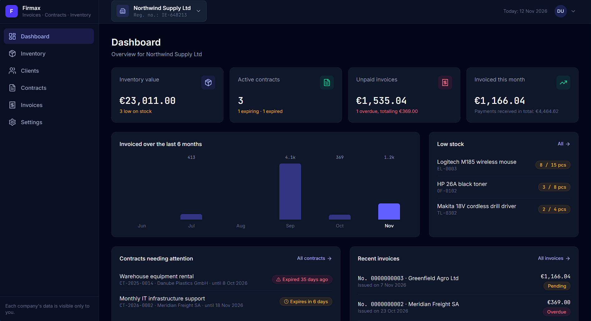
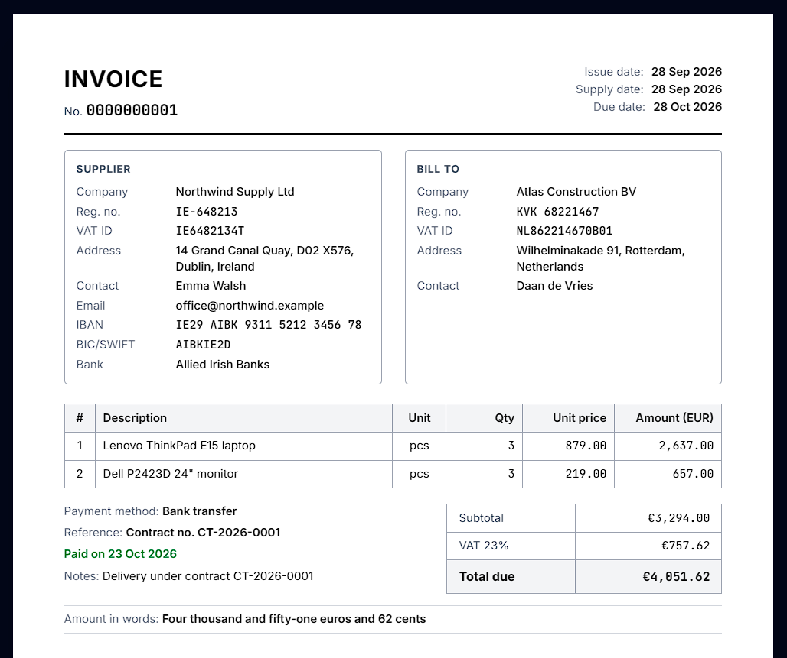
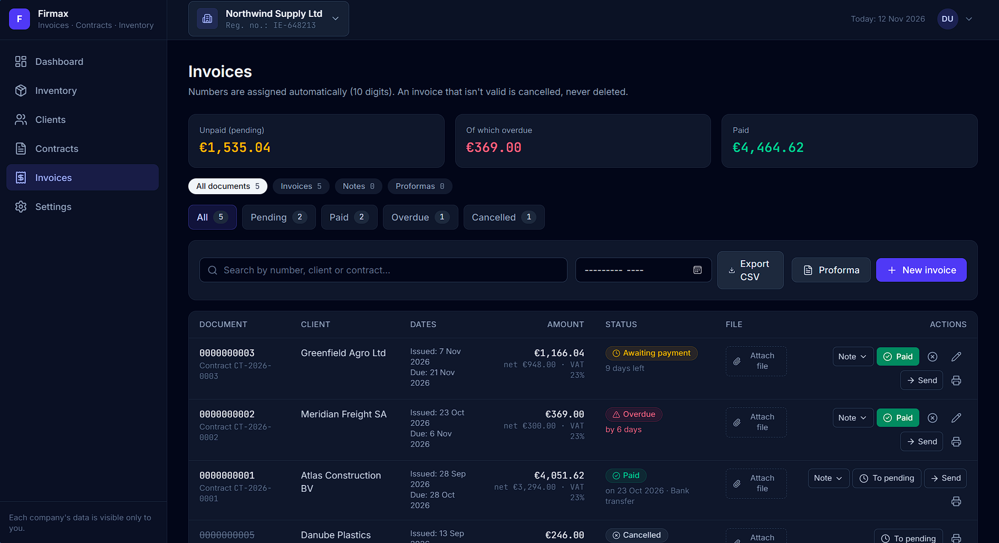
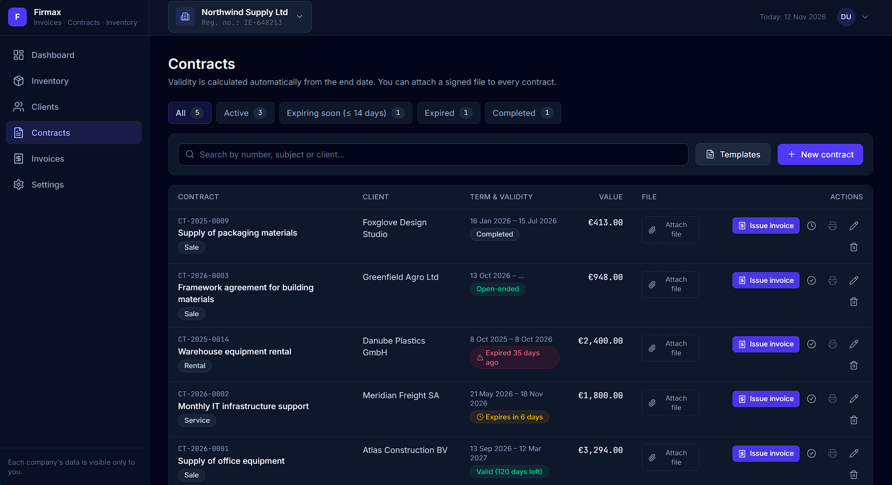
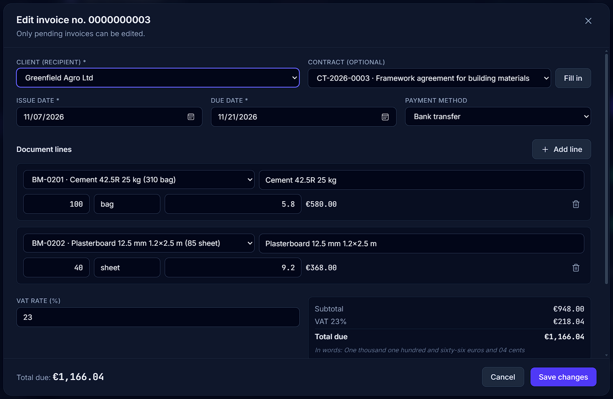

# Firmax

Free, open-source invoicing and lightweight ERP for small businesses: invoices, credit notes and proformas, contracts from
templates, recurring billing, inventory and clients — in one web app you run on your own server.

**Stack:** Next.js 16 (App Router, Server Actions) · React 19 · TypeScript · PostgreSQL (raw `pg`, no ORM) · Tailwind CSS v4 · Nodemailer

> **License:** [MIT](LICENSE) — free to use, modify and self-host.



| Invoice (A4 print view) | Invoices |
| --- | --- |
|  |  |
| **Contracts** | **Invoice editor** |
|  |  |

## How this was built

Firmax was built with AI coding assistants. I came up with the idea and defined the product: the features, the business
rules (numbering, credit notes, recurring billing, multi-company accounts), the data model and the UX. I directed the
implementation, tested every feature and decided on the trade-offs. The code itself was generated by AI.

## Features

- **Several companies per account** — every user can manage one or more companies; each company's data is fully separated.
- **Invoicing** — sequential 10-digit numbering per company with optional extra number series, credit and debit notes linked
  to the original invoice (with balance checks), proformas with one-click conversion, any VAT rate with exemption notes,
  amount in words and multi-currency display.
- **Contracts from templates** — templates with fields like `{{client.name}}` and `{{contract.amount}}`, a live preview and an
  items table; turn a contract into an invoice in one click.
- **Recurring billing** — monthly, quarterly or yearly invoices generated from contracts, idempotent per period (unique index),
  with automatic catch-up and optional email delivery.
- **Email & online links** — send a document from the company's name with a secure tokenised link (`/i/<token>`, `/c/<token>`),
  track when it was sent and opened, and revoke the link at any time.
- **Inventory** — stock levels with inline editing, low-stock alerts and transactional deduction when a contract is saved.
- **Clients** — VAT ID and IBAN validation and a full history of contracts and invoices per client.
- **Accounts** — sign-up, email confirmation, password reset, account deletion with all data.
- **Admin panel** — statistics for the whole installation, per-company details and support sign-in.
- **Accountant export** — monthly CSV (UTF-8 with BOM, ISO dates) that opens straight in Excel.

## Technical highlights

- **Company isolation without an ORM** — raw parameterised SQL through `pg`; the active company comes from a cookie but is
  accepted only if it belongs to the signed-in user, and every query filters by `company_id`.
- **Gap-free document numbering** — numbers are assigned by PostgreSQL inside the same transaction as the invoice, so
  concurrent requests can never skip or reuse a number.
- **Safe recurring billing** — periods are anchored to the start date (no day drift), protected by a unique index per
  period, and processed with `FOR UPDATE SKIP LOCKED` so the cron job and a page load never invoice twice.
- **Idempotent, re-runnable schema** — one `schema.sql` creates a fresh database or migrates an old one, and can be run
  any number of times.
- **Security by default** — scrypt password hashes, hashed session tokens, rate limiting, magic-byte checks on uploads,
  192-bit share tokens and CSV formula-injection protection.

## Getting started

Requirements: Node.js 20+, Docker (for PostgreSQL).

```bash
# 1. Start PostgreSQL
docker compose up -d

# 2. Install dependencies and configure the environment
npm install
cp .env.example .env.local   # Windows: copy .env.example .env.local

# 3. Create the schema and demo data
docker cp schema.sql erp_postgres:/tmp/schema.sql
docker exec erp_postgres psql -U erp_admin -d erp_database -v ON_ERROR_STOP=1 -f /tmp/schema.sql

# 4. Run the app
npm run dev
```

Open http://localhost:3000 and sign in with the demo account **demo@erp.local / demo12345**
(it owns two demo companies with clients, contracts and invoices).

`schema.sql` is idempotent — run it again after every update. It also migrates databases created by earlier versions.
To start from scratch (drops all data): add `-v reset=1` to the `psql` command.

## Running it for real

1. Use a strong `PGPASSWORD` (also in `docker-compose.yml`) or a managed PostgreSQL via `DATABASE_URL`.
2. Set `APP_URL` to your domain, `COOKIE_SECURE=true` behind HTTPS, and configure SMTP so confirmation and password emails arrive.
3. Delete the demo account (or reset the database without demo data) before real users sign up.
4. Build and start: `npm run build && npm start`, behind a reverse proxy (Nginx, Caddy) that terminates HTTPS.
5. The rate limiter reads the client IP from `X-Forwarded-For`, so make sure your proxy **overwrites** that header.
   It keeps its counters in memory, which is fine for a single server.
6. Schedule the recurring-billing endpoint once a day (see below).

## Configuration

All settings live in `.env.local` — see [`.env.example`](.env.example) for the full list.

| Variable | Purpose |
| --- | --- |
| `PG*` / `DATABASE_URL` | PostgreSQL connection |
| `APP_URL` | Public URL, used in email links |
| `NEXT_PUBLIC_APP_TIMEZONE` | Business time zone for "today" and due dates (default `UTC`) |
| `ADMIN_PASSWORD` | Enables the admin panel at `/admin` (at least 10 characters) |
| `COOKIE_SECURE` | `true` when the site runs over HTTPS |
| `SMTP_*`, `MAIL_FROM` | Outgoing email; without SMTP the links are printed to the console |
| `CRON_SECRET` | Enables `/api/cron/recurring` |
| `NEXT_PUBLIC_APP_NAME` | Name shown in the UI and emails (default `Firmax`) |
| `NEXT_PUBLIC_REPO_URL` | Source code link on the landing page |

### Recurring invoices

Due invoices are generated whenever the dashboard is opened. As a safety net, call the cron endpoint once a day:

```bash
curl -fsS -H "Authorization: Bearer $CRON_SECRET" https://your-domain/api/cron/recurring
```

### Email

Any SMTP provider works (Brevo, Resend, Mailgun, SendGrid, Google Workspace). Set up SPF, DKIM and DMARC for your domain
so emails don't land in spam.

## Project structure

```
app/
  (auth)/            sign-in, sign-up, password reset
  dashboard/         the app: invoices, contracts, clients, inventory, settings, account
  admin/             admin panel for the installation
  api/               CSV export, file downloads, cron
  i/[token], c/[token]   public document links
  lib/               auth, database, numbering, recurring billing, email, validation, labels
  components/        shared UI (modals, toasts, document renderers)
schema.sql           idempotent schema, migrations and demo data
```

## Security notes

- Passwords are hashed with scrypt; only SHA-256 hashes of session and one-time tokens are stored.
- Company isolation: every query filters by the active company, and the active company must belong to the signed-in user.
- Uploaded files live outside `public/` and are served only through an authorised route, with magic-byte checks.
- CSV export is protected against formula injection; public links use 192-bit random tokens and are not indexed.

## Author

**Hamid Karadzha** — [karadzha.dev](https://karadzha.dev) · [LinkedIn](https://www.linkedin.com/in/hamid-karadzha/) ·
[GitHub](https://github.com/hamidaka428)

## License

[MIT](LICENSE) © 2026 Hamid Karadzha
